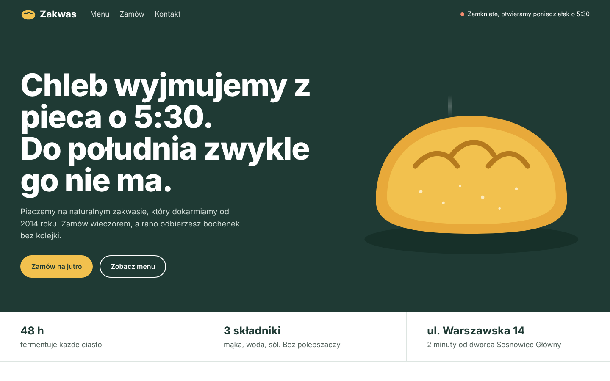

# Piekarnia Zakwas: landing page for a local bakery

**Live demo:** https://andriu-tsap.github.io/piekarnia-landing/

A one-page website for a local craft bakery (concept project, fictional brand). Built for small food businesses that want customers to see the menu, opening hours and order ahead online.

## Features
- **Live open/closed status** in the header, calculated from the opening hours ("Otwarte do 18:00" / "Zamknięte, otwieramy jutro o 5:30")
- **Menu with category tabs** (bread, pastries, coffee), rendered from a single data object, so updating prices takes one minute
- **Pre-order form**: quantity pickers, live total in PLN, pickup time, validation with clear error messages and a confirmation screen
- **Opening hours table** that highlights today
- Responsive down to 320 px, keyboard accessible, respects `prefers-reduced-motion`
- No frameworks, no build step: HTML, CSS and vanilla JavaScript

## Tech
HTML5 · CSS3 (Grid, custom properties, clamp) · JavaScript ES6+ · SVG illustration

## Run locally
Open `index.html` in a browser. That's it.

---
Design and code: [Andrii Tsap](https://andriu-tsap.github.io). The brand, address and phone number are fictional.
